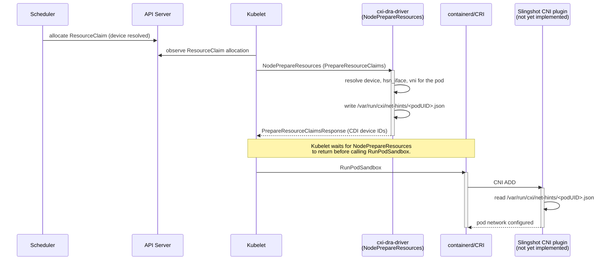

# CNI Hint-File Contract (Slingshot CNI)

This document defines the contract by which the CXI DRA driver hands off
per-pod network information (`hsn_iface`, `vni`, per device) to the Slingshot
CNI plugin. It is written from the driver side only — **no CNI
plugin binary exists yet**; this document specifies the read-side contract
so a future plugin implementation does not have to re-derive it.

## Why a file, not an API call

The CNI plugin is a separate process, invoked locally by containerd/CRI as
part of `RunPodSandbox` (CNI ADD). It has no access to this driver's
in-process `AllocationStore` ([internal/driver/store.go](../internal/driver/store.go)) — that state lives only in the
driver's daemon process. The hint file is therefore the handoff mechanism,
following the same pattern as `--netns-sysfs-root`
([internal/netsysfs](../internal/netsysfs)): the driver writes host files, and a process outside the
driver reads them.

## Ordering guarantee

Ordering between "the driver knows the device/HSN/VNI" and "CNI ADD reads the
hint file" is not a race to guard against — it is a hard sequencing guarantee
kubelet already provides, and this driver's own NRI plugin already depends on
the same guarantee for the netns sysfs handoff:

1. The scheduler allocates the claim (device resolved into
   `claim.status.allocation`).
2. Kubelet calls this driver's `NodePrepareResources` gRPC method — this
   project's `PrepareResourceClaims` — **synchronously, and waits for it to
   return** before proceeding.
3. Only after `PrepareResourceClaims` returns does kubelet call CRI
   `RunPodSandbox`, which is what triggers CNI ADD.



The customer's pod manifest never references a device directly, so there is
no earlier point at which the hint file could be needed — by the time CNI ADD
fires, the hint file for that pod already exists and is complete for every
device the pod claimed.

## Hint file schema

One file per pod, containing a JSON array with one entry per CXI device
claimed by that pod (a pod may claim more than one device, and may hold more
than one CXI claim — the file reflects the union of all devices claimed by
the pod, matching how `AllocationStore` merges per-pod state across claims):

```json
[
  { "device": "cxi0", "hsn_iface": "hsn2", "vni": 137 }
]
```

| Field | Type | Meaning |
|---|---|---|
| `device` | string | CXI device name, e.g. `cxi0` — matches the `ResourceSlice` device name |
| `hsn_iface` | string | Paired HSN interface, e.g. `hsn2` — same value as the device's `hsn_iface` `ResourceSlice` attribute |
| `vni` | int | Virtual Network Identifier assigned to the pod's namespace |

## hostPath directory convention

- Flag: `--cni-hints-dir` (default `/var/run/cxi/net-hints`; empty disables
  the hint-file write/delete). See [README.md](../README.md#configuration-flags).
- Filename: `<podUID>.json`.
- The default path is a subdirectory of `/var/run/cxi`, the same host
  directory already mounted writable into the driver container for
  `--netns-sysfs-root` — no additional volume is required for the driver to
  write hints.
- The future CNI plugin's execution context should mount this same directory
  **read-only**, the same way `--netns-sysfs-root` is mounted into the NRI
  plugin's view today.

## Driver-side lifecycle

- **Write**: `PrepareResourceClaims` writes the file for each pod in
  `claim.Status.ReservedFor` once the pod's allocation has been recorded in
  the `AllocationStore` ([internal/driver/cnihints.go](../internal/driver/cnihints.go)). The write is atomic (temp file +
  rename), so a reader never observes a partially written file. A write
  failure fails the claim's `PrepareResult`, so kubelet retries rather than
  silently proceeding to `RunPodSandbox` without a hint file.
- **Delete**: `UnprepareResourceClaims` removes the file for each pod UID
  freed by the claim. Removal failures are logged but do not block claim
  release — the pod is going away regardless.

## Observability-only side channel

The driver also best-effort patches a pod annotation
(`cxi.slingshot.hpe.com/net-hints`) with the same content as the hint file,
purely so `kubectl describe pod` shows what was assigned. **The CNI plugin
must not read this annotation** — it is not part of the read-side contract,
carries no ordering or reliability guarantee, and its writes are ignored on
failure.

## Testing

[internal/driver/cnihints_test.go](../internal/driver/cnihints_test.go) covers write/delete for single- and multi-device
pods, the disabled (`--cni-hints-dir=""`) no-op path, and the end-to-end
`PrepareResourceClaims`/`UnprepareResourceClaims` lifecycle.
