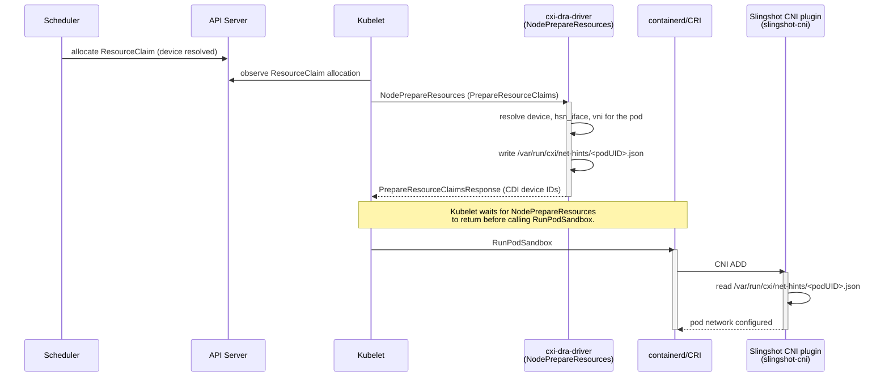

# CNI Hint-File Contract (Slingshot CNI)

This document defines the contract by which the CXI DRA driver hands off
per-pod network information (`hsn_iface`, optional `ifname`, `vni`, per device) to the Slingshot
CNI plugin. It specifies the driver-side write contract; the read side is
implemented by `slingshot-cni` ([internal/cni](../../internal/cni)), described
in [cni-plugin.md](./cni-plugin.md).

## Why a file, not an API call

The CNI plugin is a separate process, invoked locally by containerd/CRI as
part of `RunPodSandbox` (CNI ADD). It has no access to this driver's
in-process `AllocationStore` ([internal/driver/store.go](../internal/driver/store.go)) — that state lives only in the
driver's daemon process. The hint file is therefore the handoff mechanism,
following the same pattern as `--netns-sysfs-root`
([internal/netsysfs](../internal/netsysfs)): the driver writes host files, and a process outside the
driver reads them.

## Ordering guarantee

Ordering between "the driver knows the device/HSN/VNI" and "CNI ADD reads the
hint file" is not a race to guard against — it is a hard sequencing guarantee
kubelet already provides, and this driver's own NRI plugin already depends on
the same guarantee for the netns sysfs handoff:

1. The scheduler allocates the claim (device resolved into
   `claim.status.allocation`).
2. Kubelet calls this driver's `NodePrepareResources` gRPC method — this
   project's `PrepareResourceClaims` — **synchronously, and waits for it to
   return** before proceeding.
3. Only after `PrepareResourceClaims` returns does kubelet call CRI
   `RunPodSandbox`, which is what triggers CNI ADD.



The customer's pod manifest never references a device directly, so there is
no earlier point at which the hint file could be needed — by the time CNI ADD
fires, the hint file for that pod already exists and is complete for every
device the pod claimed.

**Shared claims are the exception.** Kubelet calls `NodePrepareResources`
once per claim per node, so a pod that reserves a claim already prepared on
its node (one `ResourceClaim` referenced by several pods) gets no prepare call
of its own. The driver's ResourceClaim watch (`ClaimBinder`) sees the scheduler
add the pod to `claim.Status.ReservedFor` and writes its hint from the claim's
prepared allocation. That update precedes the pod's binding, so the hint is
normally in place before CNI ADD; if it is late, the CNI's wait for the file
and kubelet's sandbox retry cover it.

## Hint file schema

One file per pod, containing a JSON array with one entry per CXI device
claimed by that pod (a pod may claim more than one device, and may hold more
than one CXI claim — the file reflects the union of all devices claimed by
the pod, matching how `AllocationStore` merges per-pod state across claims):

```json
[
  { "device": "cxi0", "hsn_iface": "hsn2", "vni": 137 }
]
```

| Field | Type | Meaning |
|---|---|---|
| `schema_version` | int, optional | Per-entry schema version; absent is the legacy unversioned format. Version `1` includes the optional `ifname`; the driver writes version `1` for VF hints. The CNI supports versions through `1`. |
| `device` | string | CXI device name, e.g. `cxi0` — matches the `ResourceSlice` device name |
| `hsn_iface` | string | The host link the CNI attaches the pod interface to: a PF netdev in PF mode or a VF netdev in VF mode. Same value as the device's `hsn_iface` `ResourceSlice` attribute; not necessarily the pod-side name. |
| `ifname` | string, optional | Preferred pod-side interface name. When absent or empty, the CNI uses `hsn_iface`. |
| `vni` | int | Virtual Network Identifier assigned to the pod's namespace |

### Naming and compatibility

The file remains a JSON array. Existing unversioned hints without `ifname`
continue to work with the same names (`hsn2`, fallback `hsn2_inet`).
For a distinct pod-side name, the driver writes version 1:

```json
[
  { "schema_version": 1, "device": "cxi4", "hsn_iface": "enp197s0f1np0", "ifname": "cxi4", "vni": 137 }
]
```

Here the CNI attaches to host link `enp197s0f1np0` but names the IPVLAN
`cxi4` in the pod, falling back to `cxi4_inet` if necessary. `ADD`, `DEL`,
`CHECK`, and Whereabouts all use the selected pod-side name.

The effective name (`ifname` when non-empty, otherwise `hsn_iface`) must
leave room for the five-byte `_inet` suffix within Linux's 15-byte interface
name limit: **at most 10 bytes for the base name**. This validation also
applies to legacy hints. A long host link name is allowed when a short
`ifname` is supplied. Over-long effective names are rejected before network changes.

The CNI logs an explicit error and rejects entries with a newer
`schema_version`; negative versions are also rejected. Hint schema versions
are independent of the network config's `cniVersion`.

The PF driver writer continues to emit unversioned hints without `ifname`,
preserving its existing JSON. In VF mode the driver writes version-1 hints
with `ifname` set to the selected VF's CXI device name (for example `cxi4`);
`hsn_iface` remains the host VF netdev used as the IPVLAN parent. The NRI
synthetic sysfs entry uses that same `ifname`, with its PCI device link and
speed read from the host netdev. Use a host-installed CNI supporting the
version-1 `ifname` field before enabling this writer: older binaries without
schema validation may ignore unknown JSON fields, including `ifname`, and use
the host name instead. Do not change a live pod's effective name between
`ADD` and `DEL`/`CHECK`.

## hostPath directory convention

- Flag: `--cni-hints-dir` (default `/var/run/cxi/net-hints`; empty disables
  the hint-file write/delete). See [README.md](../README.md#configuration-flags).
- Filename: `<podUID>.json`.
- The default path is a subdirectory of `/var/run/cxi`, the same host
  directory already mounted writable into the driver container for
  `--netns-sysfs-root` — no additional volume is required for the driver to
  write hints.
- `slingshot-cni` runs directly on the host (exec'd by containerd/Multus), so
  it reads this directory in place; it only ever reads, never writes. Its
  `hintsDir` config field must match the driver's `--cni-hints-dir`.

## Driver-side lifecycle

- **Write**: `PrepareResourceClaims` writes the file for each pod in
  `claim.Status.ReservedFor` once the pod's allocation has been recorded in
  the `AllocationStore` ([internal/driver/cnihints.go](../internal/driver/cnihints.go)). The write is atomic (temp file +
  rename), so a reader never observes a partially written file. A write
  failure fails the claim's `PrepareResult`, so kubelet retries rather than
  silently proceeding to `RunPodSandbox` without a hint file. Pods that
  reserve the claim after it was prepared get their file from the claim
  watch (see [Ordering guarantee](#ordering-guarantee)).
- **Delete**: `UnprepareResourceClaims` removes the file for each pod UID
  freed by the claim. Removal failures are logged but do not block claim
  release — the pod is going away regardless.

## Observability-only side channel

The driver also best-effort patches a pod annotation
(`cxi.slingshot.hpe.com/net-hints`) with the same content as the hint file,
purely so `kubectl describe pod` shows what was assigned. **The CNI plugin
must not read this annotation** — it is not part of the read-side contract,
carries no ordering or reliability guarantee, and its writes are ignored on
failure.

## Testing

[internal/driver/cnihints_test.go](../internal/driver/cnihints_test.go) covers write/delete for single- and multi-device
pods, the disabled (`--cni-hints-dir=""`) no-op path, and the end-to-end
`PrepareResourceClaims`/`UnprepareResourceClaims` lifecycle.
